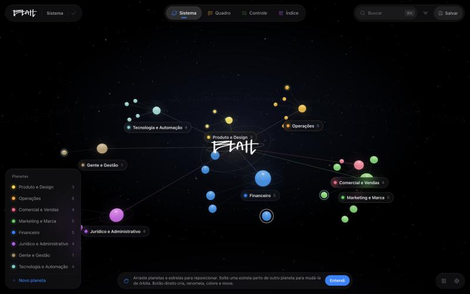
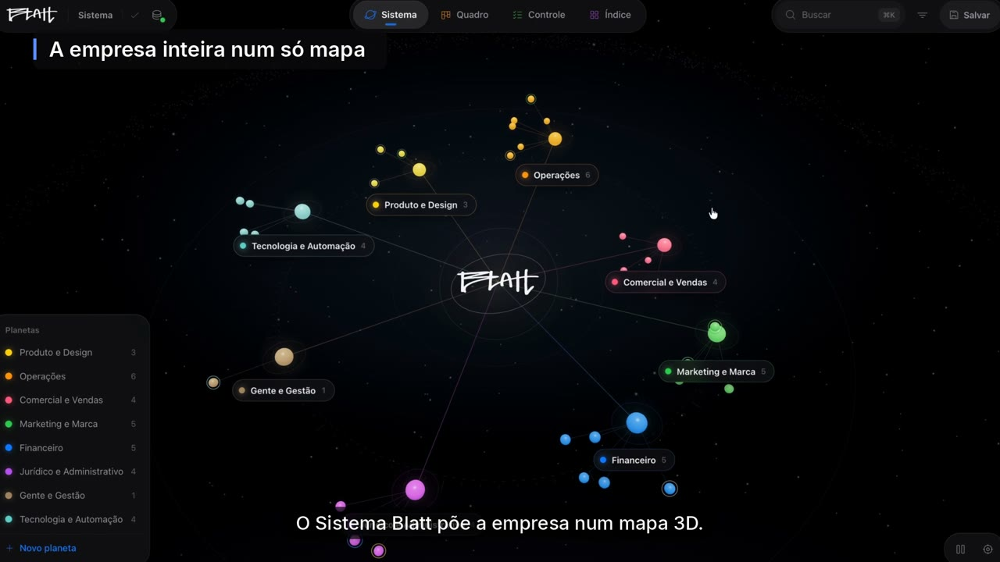

# Sistema Blatt

> **▶ [Ver a demonstração ao vivo](https://lucasmandelblatt.github.io/mapa-blatt/demo/)**: abre no navegador, sem instalar nada. Usa dados fictícios; o sistema real da Blatt é privado e protegido por senha.

O segundo cérebro da **Blatt**, marca de roupas que estou construindo com meu sócio. Todas as áreas da empresa ficam num mapa 3D: a marca é o sol, as áreas (Produto, Operações, Comercial, Marketing, Financeiro, Jurídico, Gente, Tecnologia) são planetas e os tópicos de cada área são estrelas em volta deles. Cada bloco guarda plano, tarefas com prazo, notas, fotos, arquivos e links.



### Vídeo explicativo (1min27)

[](docs/sistema-blatt-explicativo.mp4)

**▶ [Assistir ao vídeo](docs/sistema-blatt-explicativo.mp4)**: o problema que o sistema resolve e cada parte dele (mapa 3D, quadro, controle, calendário, anexos e sincronização entre os sócios).

O repositório vem **em branco**: ao instalar, o sistema abre só com o sol "Sua empresa". Você escreve o nome da empresa e dos dois sócios e cria as áreas do seu negócio. Tudo fica salvo só no seu computador. Para ver o sistema preenchido, abra a [demonstração](https://lucasmandelblatt.github.io/mapa-blatt/demo/), com dados fictícios.

## Sobre o projeto

Construído pelo autor entre 11/10 e 28/10/2026, com o Claude Code, para organizar a Blatt. Começou como um mapa estático e virou o sistema que os dois sócios usam: um no Mac, outro no Windows.

| Documento | O que tem |
|---|---|
| [`01-DECISOES.md`](01-DECISOES.md) | O que o autor decidiu, com a fala literal, a data e o efeito no código; reversões, hipóteses e aprendizados |
| [`00-BIBLIA.md`](00-BIBLIA.md) | O que o sistema é: propósito, experiência, arquitetura, regras, testes e pendências |

### O que ele mostra
| Capacidade | Onde aparece |
|---|---|
| Transformar um problema de negócio em ferramenta | Uma empresa de dois sócios, oito áreas, prazos e responsáveis num só lugar |
| Produto guiado pelo uso | Cada mudança veio de um teste real: datas erradas, salvamento, anexos integrados |
| Arquitetura que evolui | Artefato → servidor local → GitHub → Supabase + Vercel, sem reescrever a interface |
| Dados e integrações | Supabase (banco, Storage e tempo real), backup diário por GitHub Action, deploy na Vercel |
| Mostrar sem expor | A mesma interface vira uma demonstração só de leitura com dados fictícios, e o repositório público vem em branco |

### Evolução
- **11/10:** o mapa estático vira sistema editável, com estética de sistema solar.
- **12–18/10:** uso pelos dois sócios (Mac e Windows), tarefas do dia, salvamento do sistema inteiro.
- **22/10:** fotos, arquivos e links em cada tarefa, aparecendo em todas as abas.
- **26/10:** GitHub, Supabase como banco, backup diário e hospedagem na Vercel com senha.
- **28/10:** calendário real e clicável, ligado aos prazos do mapa.
- **16/11:** repositório público e demonstração ao vivo; depois, repositório recriado em branco, com os nomes dos sócios definidos no próprio sistema.

### Números
| O quê | Valor |
|---|---|
| Blocos na demonstração (áreas e tópicos) | 41 |
| Dependências do servidor | nenhuma (só módulos nativos do Node) |
| Interface | cerca de 2.200 linhas (`src/main.js`) |
| Testes automáticos | **nenhum** (ver pendências na `00-BIBLIA`) |

### Limites conhecidos
- Feito para dois sócios: os nomes se escolhem no sistema, mas não há cadastro de usuários nem permissão por pessoa.
- Não há testes automáticos; os erros foram achados pelo uso.
- O funcionamento no Windows não foi testado nesta documentação.

## Instalar e abrir

Precisa só do **Node.js** (versão LTS, gratuita, em https://nodejs.org). Não há `npm install`: o servidor usa apenas módulos nativos do Node e a interface já vem compilada em `public/app.js`.

```bash
git clone https://github.com/lucasmandelblatt/mapa-blatt.git
```

```bash
cd mapa-blatt
```

```bash
npm start
```

Abra **http://localhost:4747** no navegador. Deixe o terminal aberto enquanto usa: fechar ele desliga o sistema.

Sem Git, dá para baixar pelo botão **Code › Download ZIP** e abrir com dois cliques:

- **Mac:** `Abrir Sistema Blatt (Mac).command`. Na primeira vez o macOS pode bloquear: botão direito no arquivo, **Abrir**, confirmar.
- **Windows:** `Abrir Sistema Blatt (Windows).bat`. Se aparecer o aviso azul: **Mais informações**, **Executar assim mesmo**.

Para usar outra porta: `PORT=5000 npm start`.

## O que dá para fazer

- **Primeiro uso:** clique no sol para dar o nome da empresa e escrever o nome dos dois sócios (campo Sócios). Depois crie as áreas (botão direito no fundo ou "Novo planeta") e os tópicos de cada área (botão direito num planeta, "Nova estrela").
- **Sistema (mapa 3D):** girar, aproximar, arrastar planetas e estrelas, soltar uma estrela perto de outro planeta para mudá-la de órbita. Botão direito cria, renomeia, colore, move e apaga.
- **Quadro:** cada estrela vira um card num kanban de cinco colunas (Ideia, A fazer, Em andamento, Em aprovação, Feito), com filtro por área.
- **Controle:** o checklist de cada bloco, com responsável, prazo, destaque (normal, atenção, urgente) e anexos por tarefa. Mostra atrasos, uma linha do tempo do processo até a entrega final e um calendário mensal com todos os prazos.
- **Índice:** todas as áreas e tópicos em lista, com prazo e custo.
- **Busca** (`⌘K` ou `/`), filtros por dono e etapa, e salvamento automático com aviso de estado (Salvando, Salvo, Não salvou).

O manual completo de uso está em [LEIA-ME.md](LEIA-ME.md).

## Onde ficam os dados

O sistema tem dois modos de armazenamento, escolhidos sozinhos na hora de abrir:

| Modo | Quando | Onde |
|---|---|---|
| **Arquivos** (padrão) | sem configuração | pasta `dados/`: um JSON por bloco em `dados/nos/`, tarefas do dia em `dados/dias/`, anexos em `dados/anexos/` e o que for apagado em `dados/lixeira/` |
| **Supabase** | depois de conectar em `/conectar` | banco Postgres (tabelas `nos`, `dias`, `lixeira`) e Storage `anexos`, com tempo real entre computadores |

Quem clona o repositório começa no modo **Arquivos**, em branco. A pasta `dados/` está no `.gitignore`: o que você criar não vai para o Git. Para testar o modo em nuvem com o seu próprio projeto do Supabase (plano gratuito), abra http://localhost:4747/conectar e siga os passos: o sistema cria a estrutura e leva para o banco os dados que estão em `dados/`. O endereço e a chave ficam em `config.json`, que não vai para o Git.

No uso do dia a dia da Blatt, os dois sócios usam o modo Supabase, e um GitHub Action (`.github/workflows/backup.yml`) copia o banco e os anexos para `dados/` todo dia às 3h, num repositório privado. O workflow vem junto neste repositório, mas o job só roda em repositório **privado**: num público, ele é pulado, para os dados da empresa não ficarem abertos na internet.

## Como é feito

- **Interface:** JavaScript puro, [Three.js](https://threejs.org) e [3d-force-graph](https://github.com/vasturiano/3d-force-graph) para o mapa, empacotados com esbuild num único `public/app.js`.
- **Servidor:** `server.mjs`, Node sem dependências. Serve a interface, a API REST dos blocos e anexos e eventos em tempo real (Server-Sent Events), com escrita atômica dos arquivos e proteção contra caminhos fora da pasta de dados.
- **Banco opcional:** `supabase.mjs`, cliente mínimo do Supabase via `fetch` (REST, Storage e Realtime), com o SQL da estrutura.
- **Backup:** `scripts/backup.mjs` e o workflow do GitHub Actions.
- **Nuvem opcional:** o mesmo servidor roda na Vercel, com senha compartilhada (`BLATT_SENHA`) e o banco pelas variáveis `SUPABASE_URL` e `SUPABASE_CHAVE`.

```
server.mjs          servidor local e API
supabase.mjs        cliente do Supabase e SQL da estrutura
src/main.js         código-fonte da interface
public/             HTML, CSS, fontes, ícones e o app.js compilado
dados/              seus dados (só o bloco da empresa em branco vai para o Git)
demo/dados/         dados fictícios da demonstração
scripts/            backup diário e build do artefato
```

## Mexer no código

A interface é editada em `src/main.js` e precisa ser compilada:

```bash
npm install
```

```bash
npm run dev
```

`npm run dev` compila `public/app.js` e liga o servidor. Para só compilar: `npm run build`.

Opções do `config.json` (todas opcionais): `porta`, `dados` (outra pasta de dados), `senha` (pede senha para entrar), `supabase` (`url` e `chave`) e `github: true`, que faz cada mudança no modo Arquivos virar um commit enviado ao GitHub. Este último só funciona em um repositório onde você tem permissão de push; use um repositório privado e tire `dados/` do `.gitignore`.

## Licença

Código sob a licença MIT. Os dados da demonstração (`demo/dados/`) são fictícios.
